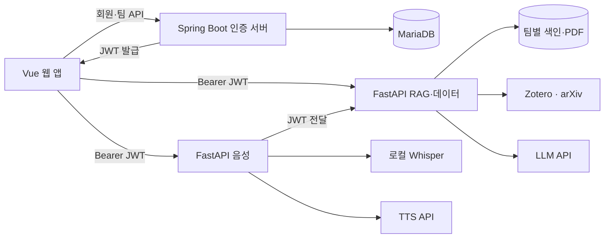

# Referoom · 레퍼룸

> 팀 논문을 검색하고, 출처와 함께 답하는 연구 어시스턴트

레퍼룸은 팀이 모은 논문을 바탕으로 개념 질의응답, 선행연구 비교, 연구 주제 제안, 원고 수치 검증을 제공하는 웹 서비스입니다. 답변에 논문·페이지 출처를 연결하고, 근거가 부족하면 논문 수집이나 원문 확인을 안내합니다.

## 제가 맡은 부분

저는 **회원·팀 관리 인증 서버, Python 공통 모듈, DB 초기화와 운영 리포트**를 맡았습니다. Java에서 발급한 토큰을 Python 서비스에서도 같은 기준으로 검증하고, 다른 팀의 자료에는 접근할 수 없도록 인증과 권한 처리를 연결했습니다.

- **인증·회원·팀 API:** Spring Boot·Spring Security·JPA로 회원가입, 로그인, 내 정보, 팀 참여·조회, 관리자 전용 목록과 초대 코드 재발급을 구현했습니다. 잘못된 Bearer 토큰이 정상 쿠키로 우회되지 않도록 처리하고, 관리자 요청에서는 토큰과 DB의 소속·역할을 함께 확인했습니다. [JWT 필터](auth-server/app/src/main/java/workplace/security/JwtAuthenticationFilter.java) · [팀 서비스](auth-server/app/src/main/java/workplace/service/TeamService.java)
- **Python 공통 기능:** RAG·음성 서비스가 함께 사용할 JWT 검증, 팀·관리자 권한, 오류 응답, 요청 로그 패키지와 테스트를 작성했습니다. 서비스별 적용은 각 담당자가 진행했습니다. [공통 인증·권한](common-py/referoom_common/auth.py) · [요청 로그](common-py/referoom_common/logging_mw.py) · [테스트](common-py/tests)
- **실행·검증 준비:** 회원·팀 DB 초기화 SQL, 개발용 시드와 인증 서버 Dockerfile을 작성했습니다. 초기 E2E 스크립트에는 로그인, 무토큰·잘못된 토큰 차단, 답변·출처 확인, 문서 밖 질문, 다른 팀 자료 비노출 검사를 넣었습니다. 이후 연구 모드·PDF 검사는 팀원이 확장했습니다. [DB 초기화](db/migrations) · [인증 서버 Dockerfile](auth-server/Dockerfile) · [E2E 점검](scripts/e2e_check.sh)
- **운영 확인:** 요청 로그에서 지연 시간, 오류, 토큰 사용량과 비용을 집계하는 스크립트를 작성했습니다. 질문·답변 원문이나 인증·개인정보가 포함된 것으로 탐지한 로그는 집계에서 제외하고 의심 행의 위치만 알리도록 했습니다. [운영·비용 리포트](scripts/ops_report.py)

RAG 검색·답변 생성, 음성 처리, 주요 프론트엔드와 전체 Compose는 팀원이 구현했습니다. 저는 이 기능들이 함께 사용할 인증·공통 처리와 실행 점검을 맡았고, 아래에는 이를 연결한 팀 전체 서비스를 정리했습니다.

### 인증에서 구분한 요청

로그인 여부만 확인하면 팀 관리 기능을 보호하기에 부족했습니다. 저는 인증 정보가 유효한지, 실제 소속 팀이 일치하는지, 관리자 권한이 있는지를 나누어 처리했습니다. 특히 토큰에 남은 역할만 믿지 않고 회원 DB의 현재 역할도 확인하도록 했습니다.

아래는 **현재 코드의 분기를 설명하기 위한 예시**이며, 실제 요청 로그나 이번 제출에서 새로 수행한 API 시험 결과는 아닙니다.

| 요청과 조건 | 처리 | 구분한 이유 |
|---|---|---|
| `GET /api/team/members` — 유효한 Bearer, 토큰·DB의 팀 일치, 양쪽 모두 관리자 | `200`, 소속 팀의 목록과 인원 수 반환 | 인증과 소속·역할 조건을 모두 만족한 요청만 허용 |
| 같은 API — 유효한 토큰이지만 일반 팀원 | `403 FORBIDDEN` | 로그인 성공과 관리자 권한은 다름 |
| 같은 API — 토큰의 팀과 DB의 현재 팀이 다름 | `403 FORBIDDEN` | 토큰의 소속 정보만으로 팀 관리 기능에 접근하지 못하게 함 |
| `GET /api/auth/check` — 잘못된 Bearer와 정상 쿠키가 함께 있음 | `401`, 쿠키로 대체하지 않음 | 명시적으로 전달한 인증 정보의 오류가 다른 인증 수단에 가려지지 않게 함 |
| `GET /api/auth/check` — Authorization 헤더 없이 정상 쿠키만 있음 | `200` | 이 경로에 한해 쿠키 기반 인증 상태 확인 허용 |

Java의 쿠키 대체 인증은 `GET /api/auth/check`에만 적용됩니다. Python 공통 모듈은 보호 경로에서 헤더가 없을 때 쿠키를 사용할 수 있지만, 잘못된 헤더를 쿠키로 우회하지 않는 기준은 같습니다. Python 권한 검사는 토큰의 클레임을 사용하며 Java처럼 회원 DB를 다시 조회하지는 않습니다. [Java 토큰 선택](auth-server/app/src/main/java/workplace/security/JwtAuthenticationFilter.java) · [팀 권한 확인](auth-server/app/src/main/java/workplace/service/TeamService.java) · [Python 검증](common-py/referoom_common/auth.py)

### 운영 리포트에 남긴 값과 남기지 않은 값

운영 리포트는 로그를 읽어 다음 항목을 서비스·API 경로별로 출력합니다. 질문이나 답변 본문을 보지 않고도 오류와 지연을 살펴보고, **실제로 측정된 토큰의 비용과 가정에 따른 예상 비용을 구분**할 수 있도록 구성했습니다.

| 출력 항목 | 계산·표시 기준 |
|---|---|
| 요청 수, 평균·최대·p95 지연, 4xx·5xx 비율 | 형식이 유효한 요청 로그를 집계. 지연에는 오류 응답도 포함 |
| 평균 입력·출력 토큰, 토큰 측정 건수 | 입력·출력 토큰이 모두 기록된 요청만 사용하고 전체 요청 수와 함께 표시 |
| 측정분 비용, 측정 요청당 비용 | 두 토큰 단가와 측정값이 있어야 산출. 단가 또는 완전한 토큰 측정 요청이 없으면 `미산정` |
| 월 예상 비용 | 집계된 대상 요청 모두에 토큰이 기록되고, 단가·인원·질문 수·근무일·서버·임베딩 비용 가정이 모두 있을 때만 산출 |
| 민감정보 의심·요청 형식 오류 | 해당 행을 집계에서 제외. 오류 건수와 민감정보 의심 유형·건수·행 번호를 표시하며 탐지한 원문 값은 출력하지 않음 |

예를 들어 요청 지연은 있지만 토큰이 기록되지 않았다면 지연 통계에는 포함하되 토큰 평균과 비용 계산에서는 제외합니다. 이때 측정된 일부 요청의 비용을 전체 청구액처럼 표시하지 않습니다. 월 예상 비용도 필요한 값이 빠지면 0원으로 채우지 않고 `미산정`으로 남깁니다. 위 내용은 **출력 형식과 계산 조건 설명**이며, 운영 비용 절감이나 실제 서비스의 지연 개선 성과를 뜻하지 않습니다. [집계·비용 계산 코드](scripts/ops_report.py)

## 검증과 확인할 점

- 제출 사본의 공통 모듈 테스트 결과는 **131개 통과**입니다. 제가 작성한 초기 테스트와 팀의 후속 변경을 포함한 통합본 기준입니다. 가상 요청과 테스트용 토큰으로 인증·권한·오류·로그 처리를 검사했으며, DB·외부 AI API·실제 비밀 환경변수는 사용하지 않았습니다.
- 기존 의존성이 설치된 Python 3.11 이상 환경에서 아래 명령으로 같은 범위를 확인할 수 있습니다. 환경 준비가 필요하면 [공통 패키지 설정](common-py/pyproject.toml)의 `dev` 의존성을 설치합니다.

```bash
cd common-py
# 새 가상환경을 준비할 때만: python -m pip install -e '.[dev]'
PYTHONDONTWRITEBYTECODE=1 python -m pytest -q -p no:cacheprovider tests
```

- 이번 제출 정리에서는 전체 서비스 E2E, 실제 모델 응답 품질, 배포·부하 시험을 다시 실행하지 않았습니다. [팀 평가 자료](eval/README.md)는 공통 모듈 테스트와 별도의 범위입니다.
- 로그아웃은 쿠키와 클라이언트의 인증 상태를 정리하는 방식입니다. 토큰 폐기 목록이나 refresh token은 구현하지 않아, 이미 발급된 Bearer 토큰은 만료 전까지 유효할 수 있습니다.
- [백엔드 구현·연동 기록](readme-parts/backend.md)은 초기 개발 시점의 설명을 포함합니다. 이후 팀 통합 과정에서 사용자 수준·관점·팀 유형 필드가 제거됐으므로 현재 계약은 소스와 실행 시 제공되는 OpenAPI를 기준으로 확인합니다.

## 팀 전체 주요 기능

| 기능 | 설명 |
|---|---|
| 회원·팀 관리 | JWT 로그인, 팀 생성·초대 코드 참여, 관리자 권한 관리 |
| 논문 라이브러리 | PDF 업로드, arXiv 후보 선택 수집, Zotero 동기화, 검색·필터 |
| 논문 튜터 | 팀 논문 기반 답변, 출처 확인, 더 쉽게·더 깊게 재질문 |
| 선행연구 비교 | 문제·방법·데이터셋·지표·결과·한계 정리표 |
| 연구 주제 제안 | 논문의 한계에 근거한 주제 후보와 실험 구성 제안 |
| 원고 검증 | 수치 주장과 논문 근거 대조, 판정표·비교 문장 초안 |
| 논문 요약 | 문제·아이디어·방법·결과·한계·확인 사항 요약 |
| 음성 튜터 | 마이크 질문 → STT → 논문 답변 → TTS 재생 |

질문 화면은 처음 접속하면 연구 모드의 선행연구 화면으로 열리고, 이후에는 마지막으로 선택한 모드를 기억합니다. 연구 모드에서 선행연구·주제·검증을 선택하고, 연구 모드를 끄면 튜터로 전환합니다. 출처를 누르면 원문 PDF의 해당 페이지를 확인할 수 있습니다.

## 아키텍처



브라우저는 인증 서버에서 JWT를 발급받아 RAG·음성 API를 직접 호출합니다. 인증 서버는 회원·팀 DB를 관리하며, Python 서비스는 공통 패키지로 JWT와 권한을 검증하고 팀별 데이터에 접근합니다.

## 기술 스택

| 영역 | 기술 |
|---|---|
| 프론트엔드 | Vue 3, Vite, Pinia, Vue Router, KaTeX |
| 인증 서버 | Spring Boot, Spring Security, JPA, BCrypt, JWT |
| RAG·데이터 | Python 3.11, FastAPI, LangChain, pypdf, sentence-transformers, numpy |
| 음성 | faster-whisper, FFmpeg, OpenAI TTS |
| 저장·배포 | MariaDB 11, Docker Compose, nginx |

코드의 기본 설정은 답변 생성 `gpt-4o`, 임베딩 `BAAI/bge-m3`, STT `small`, TTS `tts-1`·`nova`입니다. `gpt-6-luna`는 답변 생성이 아닌 평가용 판정 모델의 설정값입니다. 실행 환경에 맞게 모델 ID와 API 사용 권한을 확인해야 합니다.

## 프로젝트 구조

```text
referoom/
├── frontend/           # 웹 화면·상태·API 클라이언트
├── auth-server/        # 회원·팀 관리·JWT 발급
├── common-py/          # 공통 인증·권한·오류·로그
├── rag-service/        # 논문 수집·검색·RAG·연구 모드
├── voice-service/      # STT·TTS·음성 튜터
├── db/                 # 회원·팀 스키마
├── data/               # 시드 데이터
├── eval/               # 평가셋·평가 도구·결과
├── scripts/            # 개발 실행·E2E·운영 집계
└── docker-compose.yml  # 통합 실행
```

## 설치·실행

Docker와 Docker Compose를 준비하고 프로젝트 루트에서 실행합니다.

```bash
test -f .env || cp .env.example .env
```

`.env`에 다음 값을 입력합니다.

| 변수 | 용도 |
|---|---|
| `JWT_SECRET` | 인증·RAG·음성이 공유하는 JWT 키 |
| `DB_PASSWORD` | MariaDB 비밀번호 |
| `OPENAI_API_KEY` | 답변 생성·음성 합성 API 키 |
| `ZOTERO_GROUP_ID` | 논문 라이브러리 그룹 ID |
| `ZOTERO_API_KEY` | 그룹 읽기·쓰기·파일 접근 키 |
| `ZOTERO_TEAM_ID` | 라이브러리를 연결할 팀 ID |

```bash
docker compose up -d --build
docker compose ps
```

| 서비스 | 접속 주소 |
|---|---|
| 웹 | http://localhost:5174 |
| 인증 API 문서 | http://localhost:8080/swagger-ui/index.html |
| RAG API 문서 | http://localhost:8001/docs |
| 음성 API 문서 | http://localhost:8008/docs |

첫 실행에는 임베딩·음성 모델 다운로드와 로딩 시간이 필요합니다. 회원가입 후 팀을 생성하거나 참여하고, 해당 팀 ID를 `ZOTERO_TEAM_ID`에 설정합니다. 값을 변경하면 `docker compose up -d rag`로 RAG 서비스에 반영합니다.

```bash
# 로그 확인
docker compose logs --tail=100 auth rag voice

# 종료: 데이터 볼륨 유지
docker compose down
```

호스트 개발 실행에는 Python 3.11, Node.js·npm, JDK 21, FFmpeg와 MariaDB가 필요합니다. DB 접속 정보를 설정하고 스키마를 준비한 뒤 개발 관리 스크립트를 사용합니다.

```bash
bash scripts/dev.sh setup
bash scripts/dev.sh up auth rag voice frontend
bash scripts/dev.sh status
```

FFmpeg는 음성 녹음(webm)을 변환할 때 쓰며, 없으면 `/stt`가 503 `NOT_READY`("음성 인식 서비스를 준비 중입니다")로 실패합니다. 설치 후에는 음성 서버를 재시작하세요(`bash scripts/dev.sh restart voice`). 마이크는 `localhost` 또는 `https` 주소에서만 동작합니다.

```bash
brew install ffmpeg                # macOS
winget install Gyan.FFmpeg         # Windows (설치 후 터미널을 다시 열기)
ffmpeg -version                    # 설치 확인
curl localhost:8008/health         # {"whisper":"ready"}면 정상
```

## 팀의 역할 분담

| 구분 | 담당 영역 | 주요 기여 |
|---|---|---|
| 팀원 A | 데이터 파이프라인 | arXiv 검색·후보 조회, Zotero 저장, PDF 파서 초기 구현 |
| 팀원 B | 데이터·RAG·프론트엔드 | 라이브러리 API·로컬 색인, 근거 기반 답변·연구 모드·요약, 평가셋, 인증 연동, 연구 모드 화면·결과 컴포넌트 |
| 지원자 | 인증·공통 API·DB | 회원·팀·JWT, 공통 인증·권한·오류·로그 및 테스트, DB 초기화·시드, 인증 서버 Dockerfile, 초기 E2E 점검, 운영·비용 리포트 |
| 팀원 C | 프론트엔드 | 초기 Vue 화면, mock API, 원문 PDF 뷰어 |
| 팀원 D | 음성 서비스·배포 | STT·TTS, 음성 튜터 `/voice-qa`, 통합 Compose 구성 |
