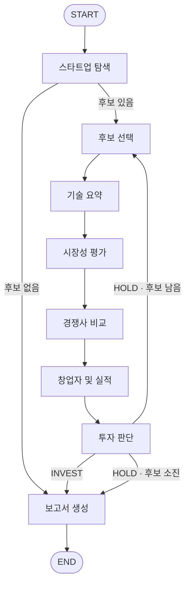

# AI Startup Investment Evaluation Agent (VentureSignal)

저전력·고효율 AI 칩 스타트업의 기술, 시장, 실적 자료를 모아 점수와 검토 보고서로 정리한 5인 팀 프로젝트입니다. 여러 에이전트가 수집한 자료를 공통 형식으로 연결하고, 분석 결과와 투자 판단을 분리했습니다.

## 제가 맡은 부분

저는 **시장성 평가와 투자 판단 에이전트의 초기 구현**을 담당했습니다. 필요한 정보가 빠졌는데도 점수가 완성된 것처럼 보이지 않도록, 생성 결과의 형식과 인용 출처를 확인하고 필수 점수가 없으면 총점 산정을 보류하는 처리를 넣었습니다.

- **시장성 평가:** 공용 RAG에서 기업별 시장 자료를 조회하고, 부족한 정보를 웹 검색으로 보완했습니다. 시장 규모를 연도·단위·출처와 함께 정리하고, 생성 결과의 인용을 입력 자료 목록과 대조했습니다. [시장성 평가 코드](agents/market_eval/node.py)
- **투자 판단:** 출력 스키마로 평가 항목과 점수 범위를 확인하고, 출처 검증과 가중합 계산을 구현했습니다. 투자조건을 제외한 필수 항목이 미산정이면 총점을 만들지 않도록 했습니다. [투자 판단 코드](agents/investment_decision/node.py) · [점수 계산](agents/investment_decision/scoring.py) · [출력 스키마](agents/investment_decision/schemas.py)
- **팀의 후속 개선:** 웹 출처 번호화, 필수 5항목의 95% 비중 재정규화, 경계 구간 추가 채점·중앙값 통합, 전체 그래프 연결과 예외 대응은 초기 구현 이후 팀에서 개선한 내용입니다. 제출 코드는 이 작업이 반영된 통합본입니다. [공동 설계 문서](docs/design.md)

## 자료와 검증 범위

이 저장소에는 에이전트 코드와 설계 문서를 담았습니다. 원본 조사 PDF·인덱스·생성 보고서와 API 키는 포함하지 않아, 전체 RAG·웹 검색·LLM 파이프라인을 실행하려면 별도 자료와 설정이 필요합니다. 조사 대상 기업·창업자·연구기관·논문 명칭은 분석 자료의 출처로 유지했습니다.

출처 검증은 인용한 ID·URL이 입력 자료에 있는지 확인하는 방식입니다. 원문 내용의 진실성이나 실제 투자 수익성을 평가한 것은 아니며, 결과는 투자 검토 과정을 구현한 실습 범위로 한정했습니다.

아래 기능·검색 평가 수치·아키텍처는 팀의 개발 기록입니다. 검색 평가는 원본 조사자료와 당시 설정에서 얻은 값이며, 이번 제출 사본에서 재측정하지 않았습니다.

## Overview

- Objective : 반도체 AI 스타트업의 기술력, 경쟁 우위, 시장성, 창업자, 실적 등을 기준으로 점수화해서 투자 적합성 분석

- Method : LangGraph 멀티 에이전트, Agentic RAG(하이브리드 검색), 웹서치(Tavily)

## 팀 전체 기능

- PDF 자료 기반 정보 추출: 원 프로젝트에서는 150쪽 조사자료를 페이지 단위로 색인해 검색했습니다. 원문과 인덱스는 이 제출본에 포함하지 않았습니다.
- 질의 조건(예: "국내", "상장사 제외")을 반영해 Top-3 후보 기업 탐색
- RAG와 웹서치로 기술·시장·경쟁·창업자·실적을 분석하고, 결과에 출처 ID·URL과 미확인 항목을 구분해 기록
- 분석과 채점 분리: 분석 에이전트는 근거만 수집하고, 투자 판단 에이전트만 Scorecard로 채점해 INVEST/HOLD 판정
- 평가표 (Score Table 방식)
  - 창업자(10%) - 분야 전문성, 이력
  - 시장성(15%) - 시장 규모, 성장 가능성
  - 제품/기술력(35%) - 성능, 완성도
  - 경쟁 우위(25%) - 독점적 자산, 모방 난도
  - 실적(10%) - 고객 확보, 매출
  - 투자조건(5%) - 다음 라운드까지의 런웨이 확보 가능성
  - 투자 여부를 판단하는 기준점은 실제 IPO에 성공한 기업의 점수
- 반도체 특화 Scorecard: 기술 복잡도가 높고, 설계 IP·공정 노하우 등 진입장벽이 높아 확보한 우위가 오래 유지되는 특성을 반영해 기술력(15→35%)·경쟁 우위(10→25%) 비중 상향
- HOLD면 다음 후보로 반복하고, 최종 결과를 SUMMARY~REFERENCE 양식의 투자 보고서로 생성

## Architecture



State 흐름: `query` → `candidates`(Top-3) → `current_candidate` → `evaluations`(기업별 분석·점수 누적, 덮어쓰지 않고 병합) → `report` (INVEST 기업은 `selected_candidate`에 기록)

## Tech Stack

- Framework : LangGraph 1.2.12, LangChain 1.4.3 (Python 3.11)
- LLM/Generator·Judge : `LLM_PROVIDER`·`LLM_MODEL` 환경변수로 제공자와 모델을 선택합니다. 제출 코드 `core/config.py`의 기본값은 `anthropic`·`claude-opus-5-5`입니다. 과거 실험 문서의 OpenAI 모델 표기와 다르므로, 재실행할 때는 사용할 수 있는 제공자·모델로 지정해야 합니다.
- Retrieval : Qdrant 로컬 모드 (bge-m3 Dense + Sparse 하이브리드, RRF) - 팀의 탐색 평가 30건 중 평균 23.2건 통과 (Top-3가 모두 정답 후보 5곳 안, 5회 평균)
- Embedding : BAAI/bge-m3 (오픈소스, MIT) — 한·영 혼용 문서 대응, Dense + Sparse 하이브리드를 한 모델로 지원, 최대 8,192 토큰, Multi-vector 확장성. 비교 후보 gte-multilingual-base보다 검색 품질을 우선해 선정
- Web Search : Tavily

## Agents

### 1. 스타트업 탐색 에이전트 (RAG)

질의에서 조건을 추출하고, 사전 구축한 조사자료 인덱스를 하이브리드 검색·재정렬해 Top-3 후보 기업을 찾는다.

- 사전 1회: `python -m rag.ingest`가 PDF를 페이지별로 읽어 메타데이터(회사, 기술/시장성, 국내/해외, 분야, 출처 번호)를 붙이고, bge-m3 의미 벡터(Dense, 1024차원)와 단어 벡터(Sparse, 전문용어 정확 일치)로 Qdrant에 저장 (출처 목록 10쪽은 별도 저장)
- ① 조건 추출(`query_parser.py`): LLM이 질의에서 "국내", "상장사 제외" 같은 조건 추출 (LLM 실패 시 규칙 기반 폴백)
- ② 검색(`retrieval.py`): 질의도 같은 방식으로 벡터화해 의미·단어 검색을 각각 수행하고, 두 순위표를 RRF로 결합
- ③ 재정렬(`ranking.py`): 조건에 맞지 않는 회사를 제외하고, 분야·기술 용어가 일치하면 가점 → Top-3
- 어기면 오답인 조건(상장 제외, 후기 투자 등)만 필터로 제거하고, 분야·용어 일치는 가점으로 반영 → 평가 30건 중 통과 8건(벡터 검색만) → 23~24건
- 검색 대상은 회사당 기술 페이지 1장(총 50장)이라 결과가 곧 회사 목록이며, "국내" 요구 시 검색 전에 국내 회사 8곳만 남김
- 기업 상태·탐색 태그는 PDF 본문에서 따로 읽어(`catalog.py`) 필터·점수에 사용하고, 상장·인수 기업은 질의가 비상장·독립을 요구할 때 제외

### 2. 후보 선택 (함수)

후보 목록에서 아직 평가하지 않은 후보 1곳을 꺼내 `current_candidate`로 지정하고 `candidate_index`를 1 증가시킨다.

### 3. 기술 요약 에이전트 (RAG + 웹서치)

후보 기업의 기술을 조사자료(PDF) 검색 → 1차 요약 → 웹서치 보강 → 출처 검수 순서로 분석해 `technology`로 정리한다. 조회 자료에 없는 출처를 제거하고, 출처가 없는 항목은 미확인으로 바꾼다.

- 후보 기업의 `company_id`로 조사자료(PDF)의 기업 기술 페이지를 조회하고, 기술 공통 주제를 하이브리드 검색(bge-m3 Dense + Sparse)으로 보강
- 조사자료 기반 1차 요약으로 핵심 기술, 제품, 개발 단계, 성능·전력, 강점과 한계 정리
- 조사자료만으로 파악하기 어려운 양산·고객, SDK, 벤치마크 정보는 웹서치로 찾아 2차 요약에서 보강
- 출처 검수를 통해 실제 조회한 자료의 출처(source_id·URL)만 남기고, 출처 없는 수치와 검색 결과 본문에 없는 웹 수치는 제외
- 공개 사실, 회사 주장, 분석을 구분하고 웹에서 가져온 내용은 `web`으로 남김
- 출처 검수를 통과하지 못한 항목은 `unverified`에 남기고, 사용 가능한 출처가 하나도 없으면 근거 부족으로 반환

### 4. 시장성 평가 에이전트 (RAG + 필요 시 웹서치)

기업별 시장성 자료와 시장 공통 자료로 먼저 분석하고, 정보가 부족할 때만 웹서치로 보완해 `market`으로 정리한다.

- RAG 검색 범위: 기업별 시장성 페이지(`company_market`)와 시장 공통 주제(`market_topic`)
- 웹서치 대상: 시장 규모·성장 또는 고객 수요·도입 (기업당 목적별 최대 1회, 전체 최대 2회, 검색당 결과 3개)
- 정리 항목: 목표 고객, 시장 규모(범위·연도·단위·출처), 성장 요인, 수익 구조, 도입 장벽
- 성장 요인은 기업 매출 성장과 구분하며, 시장 성장만으로 기업 매출을 예측하지 않음
- 시장 규모 등 확인하지 못한 정보는 미확인으로 별도 기록

### 5. 경쟁사 비교 에이전트 (웹서치)

평가 기업 확인 → 웹 검색(최대 3회) → 경쟁 제품 비교 → 결과 제출 → 출처 URL 검증 순서로 진행하고, 검증을 통과한 결과만 `competition`으로 저장한다.

- 현재 평가 기업과 같은 고객 문제를 해결하는 경쟁 제품을 찾아 비교 (입력: `current_candidate`, `candidates`의 이름·설명·사업 분야)
- Tavily 웹서치, 검색당 최대 5개 결과
- 비교 항목: 제품의 용도·고객, 성능·전력, 가격·도입 조건, 강점·약점, 출처
- 근거 URL과 경쟁 제품 출처 URL이 실제 검색 결과에 있는지 검증. 실패 시 수정 또는 재검색(`recursion_limit=24`)하고, 끝까지 통과하지 못하면 저장하지 않고 오류 발생
- 비교 조건이 다르거나 확인되지 않은 정보는 우열로 단정하지 않고 별도 기록
- 출력 `details`: 경쟁사별 제품 정보(`peer_products`), 비교 조건, 미확인 정보, 핵심 위험 (`evidence`는 검색 결과 URL)

### 6. 창업자 및 실적 에이전트 (웹서치)

창업자·실적·투자조건을 웹에서 조사해 `team`·`traction`·`deal_terms`로 정리한다.

- 기업명과 CEO 이름을 기반으로 창업자 및 공동창업자 정보 탐색
- LinkedIn과 공식 웹 자료에서 학력, 경력, 전문성, 논문 및 제품 실행 경험 수집
- 고객, PoC, 계약, 매출 및 상용화 실적 분석
- 투자 유치 이력, 기업가치, 투자조건 및 런웨이 확인
- 출처 ID와 인용문을 조회 원문에 대조하고, 일치하지 않는 인용이 붙은 항목은 제외
- 남은 자료를 바탕으로 분석하고, 확인이 필요한 내용과 자료 부족 상태를 별도 표시

### 7. 투자 판단 에이전트 (LLM)

6개 분석 결과를 받아 LLM이 항목별 점수(0~5)와 근거를 산출하고, 가중합·판정은 코드(`scoring.build_core_scorecard` / `scoring.decide`)로 계산한다.

- 입력: 현재 후보의 분석 결과 6개 (`technology`, `market`, `competition`, `team`, `traction`, `deal_terms`)
- Scorecard 비중: 제품/기술력 35% · 경쟁 우위 25% · 시장성 15% · 창업자 10% · 실적 10% · 투자조건 5%
- 판정 점수(핵심 점수): 필수 5항목(기술력·경쟁 우위·시장성·창업자·실적)의 가중합을 비중 합 95%로 나눠 100점으로 환산. 투자조건은 웹 조사로 확인이 어려워 참고용으로만 표시하고 총점에서 제외
- 하한값 59.3점: 상장에 성공한 기준 기업 3곳(싸이닉솔루션 57.9 · 그린리소스 60.0 · Ambiq 60.0)을 같은 방식으로 채점한 점수의 평균. 총점이 이 값을 넘으면 INVEST, 아니면 HOLD
- 고정 기준값을 읽지 못하면 설정의 임시 하한값 70.0을 사용하고, `decision_basis`에 임시 기준 사용 여부와 이유를 기록
- 총점이 없거나 하한값 ±5점 이내면 채점을 2회 더 시도해 성공한 결과의 항목별 중앙값을 사용한다. 추가 채점 후에도 필수 항목이 미산정이면 총점 없이 근거 부족 HOLD로 처리한다(0점·기본점수로 채우지 않음).
- INVEST면 `selected_candidate`에 기업 ID를 기록하고 보고서 생성으로 이동
- HOLD이고 후보가 남으면 다음 후보로 반복, 후보가 소진되면 보고서 생성으로 이동

### 8. 보고서 생성 에이전트 (LLM)

State 전체를 입력으로 설계 문서 E절 양식에 맞춘 마크다운 투자 보고서를 작성한다.

- 목차: SUMMARY → 사업 아이디어와 팀 → 실적·투자조건 → 시장·경쟁 → 기술력 → 리스크 → 종합 평가 → REFERENCE (양식: `agents/report_writer/template.md`)
- `evidence`의 출처 ID·URL로 출처 번호를 만들고 REFERENCE에 서지정보 기재
- 전 후보가 HOLD이면 보류 사유와 재검토 조건 포함

## Directory Structure

```
VentureSignal/
├── agents/                   # 에이전트별 폴더 (진입점: node.py 의 run(state))
│   ├── startup_search/       # 스타트업 탐색 (RAG)
│   ├── candidate_select/     # 후보 선택 (함수)
│   ├── tech_summary/         # 기술 요약 (RAG + 웹)
│   ├── market_eval/          # 시장성 평가 (RAG + 웹)
│   ├── competitor_compare/   # 경쟁사 비교 (웹)
│   ├── founder_traction/     # 창업자 및 실적 (웹)
│   ├── investment_decision/  # 투자 판단 (LLM, scoring.py)
│   └── report_writer/        # 보고서 생성 (LLM, template.md)
├── prompts/                  # 에이전트별 LLM 프롬프트 (<에이전트>.py)
├── core/                     # 공용 State·LLM·설정
├── graph/                    # LangGraph 조립 (builder.py)
├── rag/                      # PDF 파싱·임베딩·Qdrant·검색
├── tools/                    # Tavily 웹검색
├── docs/design.md            # 식별 정보를 제외한 공동 설계 문서
├── tests/                    # pytest
├── outputs/                  # 실행 시 보고서 저장 위치, 제출본에는 보고서 없음
├── main.py                   # 실행 진입점
└── requirements.txt
```

## 역할 분담

| 구분 | 담당 범위 |
|---|---|
| **지원자** | 시장성 평가·투자 판단 에이전트 초기 구현. 자료 조회, 인용 대조, 평가 출력 검증, 가중합 계산 및 필수 항목 미산정 처리 |
| 팀원 A | 스타트업 탐색, 보고서 생성, LangGraph 통합 및 후속 통합 개선 |
| 팀원 B | 기술 요약, RAG 기술 분석과 웹 보강, 출처 검수 |
| 팀원 C | 경쟁사 비교, 웹 검색을 통한 경쟁 제품 조사와 출처 URL 검증 |
| 팀원 D | 창업자·실적·투자조건 조사, 원문 인용 검증 |
| 팀 공동 | 시스템 구조, 공통 설계 문서, 에이전트 역할 분담과 State·Scorecard 구조 설계 |

팀원은 역할로 구분했습니다. 코드·설계의 기존 권리는 유지하며, 이 사본에 별도의 이용 허락을 추가하지 않았습니다.
